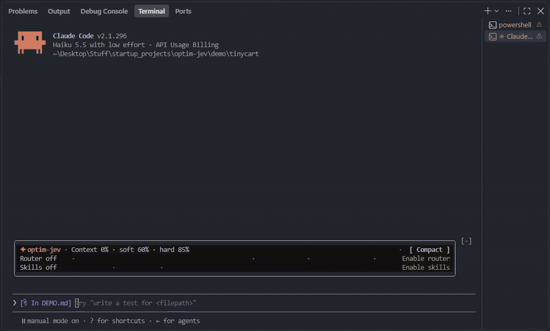
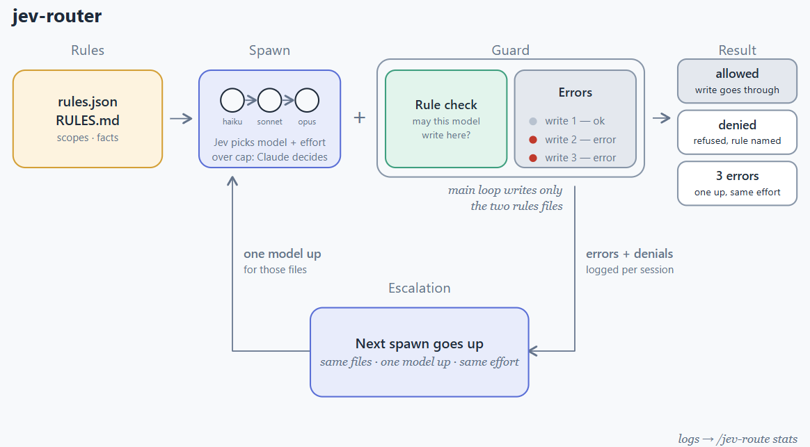
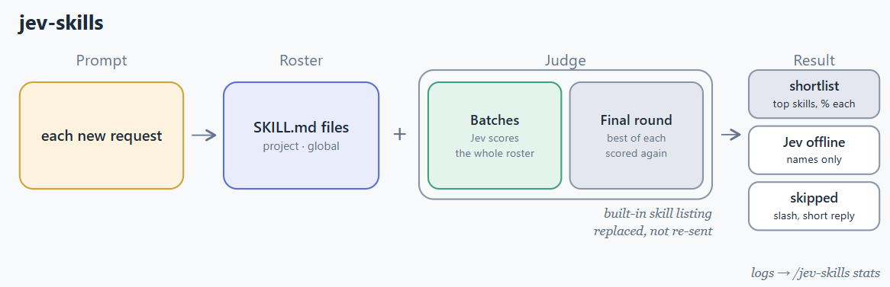

<div align="center">

# optim-jev

**Spend fewer tokens in long agent sessions without changing how you work.**

Jev-powered optimization for Claude Code, plus model routing for OpenAI Codex.

[](https://code.claude.com/docs/en/overview)
[](https://developers.openai.com/codex/plugins)
[](#license)
[](https://discord.gg/EpUxGjNBva)

[Get started](#claude-code-quick-start) · [Codex support](docs/codex.md) · [Documentation](docs/README.md) · [Architecture](docs/architecture.md) · [Contributing](docs/contributing.md)



</div>

## Why optim-jev?


Long agent sessions accumulate stale tool output, send oversized skill catalogs, and use the main model for work a smaller model could handle. Claude Code supports all three optimizers below. Codex supports the model router and an off-by-default advisory skill experiment.

Each tool works independently and fails open if unavailable. Measured cost reports remain Claude-only.

## Three tools, one project

| Tool | What it does | Available in | Claude default | Learn more |
|---|---|---|:---:|---|
| **jev-compacter** | Removes stale tool calls and outputs instead of summarizing away the whole conversation | Claude Code | On | [Guide](docs/jev-compacter.md) |
| **jev-router** | Runs each subagent, Explore searches included, on the cheapest model that fits, within project rules that evolve with your workflow | Claude Code and Codex | Off | [Guide](docs/jev-router.md) |
| **jev-skills** | Sends a short, relevant skill list for each prompt instead of the entire catalog | Claude Code; experimental advisory mode in Codex | Off | [Guide](docs/jev-skills.md) |

<details>
<summary><strong>jev-compacter — preserve useful context</strong></summary>

<br>


It works automatically with `/compact` and auto-compaction. Inspect the current session with:

```text
/jev-compact stats
```

Want it to prune earlier or keep more? Pick a **Compaction: style** (`balanced`, `save-tokens`, or `keep-context`) in `/config` under optim-jev. See [Pick a style](docs/jev-compacter.md#pick-a-style).

</details>

<details>
<summary><strong>jev-router — the right model for every subagent</strong></summary>

<br>


Your main conversation keeps its model, so its prompt cache stays warm. The routing happens where it pays off: every subagent Claude spawns gets its own model and effort from Jev, Explore searches included. A quick lookup runs on haiku; a deep architecture review gets a stronger model.

Claude works as usual, editing directly and delegating when a task calls for it or when you ask. `rules.json` sets which models may edit each path; when a path needs a different model than your session's, Claude hands that change to a routed subagent.

```text
/jev-route init "what matters in this project"
/jev-route on | off
/jev-route why | stats
```

Tell Claude to change a preference later—for example, “let haiku edit the tests”—and the project rules update with your workflow.

</details>

<details>
<summary><strong>jev-skills — load only relevant skills</strong></summary>

<br>


```text
/jev-skills on | off
/jev-skills scope project | global
/jev-skills why | stats | reindex
```

</details>

## Claude Code quick start

### Requirements

- [Claude Code](https://code.claude.com/docs/en/overview) with plugin support
- Python 3.10 or newer
- A TypeSafe API key for Jev

### Install

```bash
git clone https://github.com/Oqura-ai/optim-jev.git
claude plugin marketplace add ./optim-jev
claude plugin install optim-jev@optim-jev
```

Set the key in Claude Code under `/config` → **TypeSafe API key**, or export it before starting Claude Code:

```bash
export TYPESAFE_API_KEY="your-key"
```

Restart Claude Code. jev-compacter is ready immediately; enable the router and skill picker when you want them. See [Getting started](docs/getting-started.md) for every command, option, and troubleshooting step.

> [!NOTE]
> The plugin uses only Python's standard library. Your API key is passed to child processes through the environment and is never written to project files or logs.

## OpenAI Codex support — new

Start with the complete [Codex guide](docs/codex.md) for installation, usage, model-tier setup,
verification, limitations, troubleshooting, and uninstall steps.

optim-jev can automatically route each Codex subagent to an account-specific `fast`, `balanced`, or
`strong` model. It also selects reasoning effort, applies project path rules, escalates after
failures, and can provide an optional advisory skill shortlist. Claude and Codex keep separate
model catalogues, policies, caches, and logs.

> [!IMPORTANT]
> **Compaction is not supported in Codex.** Codex hooks cannot replace live conversation history.
> The AbovePrompt dashboard, slash commands, and measured token and cost reports are also
> Claude-only.

### Install and use

Codex CLI 0.162.1 or newer can install optim-jev directly from GitHub. No PyPI release or manual
clone is required.

```powershell
py -3 -m pip install "https://github.com/Oqura-ai/optim-jev/archive/refs/heads/main.zip"
optim-jev codex install

$env:TYPESAFE_API_KEY = "your-key"
cd C:\path\to\your-project
optim-jev codex setup
optim-jev codex status
codex
```

On the first Codex launch after install or update, run `/hooks`, review and trust every optim-jev
hook, then restart Codex.

Inside Codex, subagent routing is automatic. Check the most recent decision or control project
features with:

```text
!optim-jev codex why
!optim-jev codex status
!optim-jev codex on
!optim-jev codex off
!optim-jev codex skills-on
!optim-jev codex skills-off
```

## Documentation

| Resource | What you will find |
|---|---|
| [Getting started](docs/getting-started.md) | Installation, configuration, commands, and troubleshooting |
| [Codex support](docs/codex.md) | Codex installation, router setup, configuration, and limitations |
| [TinyCart demo](demo/tinycart/DEMO.md) | A short, repeatable showcase of all three tools on a toy project |
| [Performance metrics](docs/performance-metrics.md) | How token usage, cost, and estimated savings are calculated |
| [Architecture](docs/architecture.md) | The TypeScript-to-Python bridge, data flow, and session logs |
| [Contributing](docs/contributing.md) | Local setup, tests, conventions, and pull requests |

## Community and support

- Found a bug or have a feature idea? [Open an issue](https://github.com/Oqura-ai/optim-jev/issues/new/choose).
- Want to help? Read the [contributing guide](docs/contributing.md) and submit a focused pull request.
- For the wider Claude Code community, join the official [Claude Developers Discord](https://anthropic.com/discord).

## License

optim-jev is released under the MIT License.

<div align="center">

Built by [Oqura.ai](https://github.com/Oqura-ai) for more efficient coding-agent workflows.

</div>
