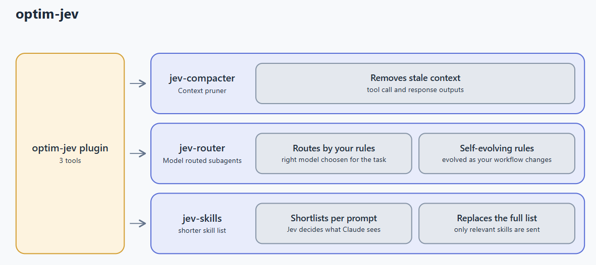

# Architecture



optim-jev has explicit Claude Code and Codex adapters over shared Python decision engines. Claude
supports all three tools; Codex supports the router and an off-by-default advisory skill experiment.

## Two halves

```
 Claude Code, Codex, or CLI                   Python process, one per hook/tool call
 ─────────────────────────                   ──────────────────────────────────────
 hooks/optim-jev.ts ─────┐                ┌─► optim_jev.tools.<tool>.tool
 optim_jev/hosts/codex.py├─ JSON/functions┤
 optim_jev/cli.py ───────┘                └─► decisions, persistence, Jev calls
                                                         │
                                                         └── HTTPS ──► Jev API
```

- **TypeScript** ([`hooks/optim-jev.ts`](../hooks/optim-jev.ts), [`hooks/router-lib.ts`](../hooks/router-lib.ts), [`hooks/dashboard.tsx`](../hooks/dashboard.tsx)) is the Claude adapter. It can replace live conversation history, render UI, and call Claude-specific APIs.
- **Python host adapter** ([`hosts/codex.py`](../src/optim_jev/hosts/codex.py)) receives Codex command-hook events. It converts host fields, applies router answers, and fails open on adapter errors; explicit policy denials remain denials.
- **Python CLI** ([`cli.py`](../src/optim_jev/cli.py)) owns deterministic Codex setup and project-local mode changes. It never asks the host model to edit configuration.
- **Python** ([`src/optim_jev/`](../src/optim_jev/)) holds the logic. It starts fresh on every call, so anything that must survive between calls is written to `.optim-jev/`.

Every Python call is the same shape:

```
python -m optim_jev.tools.jev_router.tool spawn
  stdin : {"session_id": "...", "project_dir": "...", "options": {...}, ...mode fields}
  stdout: {...answer}
```

- Claude sets `PYTHONPATH` to the repository's `src/`; the Codex launcher imports the installed
  `optim_jev` distribution. The API key travels as `TYPESAFE_API_KEY`, never in stdin.
- A non-zero exit becomes an error in the hook, carrying the last 3 lines of stderr. Each hook decides its own fallback (usually: do what Claude Code would have done without the plugin).
- Claude options reach Python as plugin `userConfig`. Codex reads project-local
  `.optim-jev/config.json` plus `OPTIM_JEV_*` environment overrides.

## Loading

| File | Role |
|---|---|
| [`.claude-plugin/plugin.json`](../.claude-plugin/plugin.json) | name, version, and every user option |
| [`.claude-plugin/marketplace.json`](../.claude-plugin/marketplace.json) | lets the repo be added as a marketplace |
| [`hooks/hooks.json`](../hooks/hooks.json) | `{"modules": ["./optim-jev.ts"]}`: names the hooks module |
| [`hooks/optim-jev.ts`](../hooks/optim-jev.ts) | `register()` runs on every load or reload and subscribes all hooks |
| [`hooks/dashboard.tsx`](../hooks/dashboard.tsx) | pure formatting and rendering for the three-tool dashboard |
| `.claude-plugin/types/` | editor types, regenerated by Claude Code on load |
| [`codex-plugin/.codex-plugin/plugin.json`](../codex-plugin/.codex-plugin/plugin.json) | Codex manifest, kept separate from Claude metadata |
| [`.agents/plugins/marketplace.json`](../.agents/plugins/marketplace.json) | repo-local Codex marketplace; packages only `codex-plugin/` |
| [`codex-plugin/hooks/codex-hooks.json`](../codex-plugin/hooks/codex-hooks.json) | Codex command-hook events and cross-platform launchers |
| [`src/optim_jev/cli.py`](../src/optim_jev/cli.py) | deterministic `optim-jev codex ...` control surface |

## Hooks used

| Event | Used by | For |
|---|---|---|
| `session.start` | all | register commands, restore per-session modes, build the skill index |
| `command.run` | all | `/jev-compact`, `/jev-route`, `/jev-skills` |
| `session.compact` | compacter | replace the built-in summary with a Jev prune |
| `turn.complete` | all | auto-compaction check, router outcome, usage log flush |
| `turn.start` | router | reset per-turn counters |
| `turn.step` | router | apply each routed subagent's effort to its requests |
| `prompt.compose` | router | add the routing instructions to the system prompt |
| `prompt.submit` | skills | attach the shortlist to the prompt |
| `prompt.attachment` | skills | replace the built-in skill listing |
| `tool.call` | router | guard writes, count errors, re-check edited rules |
| `tool.check` | skills | allow reading skill folders in global scope |
| `agent.spawn` | router | pick the subagent's model and effort, extend its prompt |
| `skill.prompt` | skills | log which skills were actually loaded |
| `ui.render` (`AbovePrompt`) | all | render live state and controls without doing I/O |

`session.start` and `turn.complete` are shared: one handler each, calling into every tool in turn.

### Codex hooks

`SessionStart` injects static router instructions. `PreToolUse` rewrites Codex's flattened
`collaborationspawn_agent` calls and guards recognized writes. Multi-Agent V2 exposes delegated
messages to local hooks as ciphertext, so Codex routing uses the visible task name plus recent root
prompts and leaves the ciphertext unchanged. `PostToolUse` links child agents and records failures.
`UserPromptSubmit` records recent root prompts for routing and runs the optional advisory skill
experiment only when explicitly enabled. No compaction hooks are installed because Codex cannot
replace live history.

## Source layout

```
src/optim_jev/
├── cli.py              deterministic Codex setup, modes, status, and why
├── core/
│   ├── paths.py      the project's .optim-jev/ folder
│   ├── logs.py       per-session JSONL logs; `python -m optim_jev.core.logs claude` writes Claude usage
│   └── pricing.py    prices and the readers every stats command shares
├── hosts/
│   └── codex.py      Codex hook contracts, routing mutations, and guard target extraction
└── tools/
    ├── jev_compacter/   see jev-compacter.md
    ├── jev_router/      see jev-router.md
    └── jev_skills/      see jev-skills.md
```

Each tool has a `tool.py` entry point with a `HANDLERS` table of modes, and a `config.py` with its defaults. The Jev HTTP client lives in [`jev_compacter/jev.py`](../src/optim_jev/tools/jev_compacter/jev.py) and is shared by all three.

## Data on disk

Everything is under `<project>/.optim-jev/`. Nothing is written to `~/.claude/`.

```
.optim-jev/
├── .gitignore            ignores runtime state; keeps each host's policy files
├── config.json           local: Codex feature settings
├── jev_router/
│   ├── rules.json        Claude: which models may write where     (commit it)
│   ├── RULES.md          Claude: facts about the codebase         (commit it)
│   ├── rules.codex.json  Codex: which tiers may write where       (commit it)
│   ├── RULES.codex.md    Codex: facts about the codebase          (commit it)
│   ├── models.json       local: Claude models this account can use
│   └── models.codex.json local: validated Codex tier-to-model mapping
├── jev_skills/
│   ├── index.json        local: cached Claude skill index
│   └── index.codex.json  local: cached Codex skill index
└── logs/                 local: one JSONL file per session per tool
    ├── claude/
    ├── codex/
    ├── jev_compacter/
    ├── jev_router/
    ├── jev_router_codex/
    ├── jev_skills/
    └── jev_skills_codex/
```

### Session logs

Each line is one JSON record with a `ts` and a `kind`. Files are appended to, never rewritten, so a killed process can at worst leave one cut line, which readers skip.

| File | Kinds |
|---|---|
| `claude/<session>.jsonl` | `turn` (Claude's 4 token counts per turn, main loop or subagent), `summary` (a built-in summary's usage), `spawned` (links a subagent id to its routed model), `init` |
| `jev_compacter/<session>.jsonl` | memory snapshots (`schema` field; the last one is the live memory) and `compaction` outcomes |
| `codex/<session>.jsonl` | hook metadata, route-to-agent links, failures, denials, and escalations |
| `jev_router/<session>.jsonl` | Claude `spawn` and `outcome` records |
| `jev_router_codex/<session>.jsonl` | Codex `spawn` and `outcome` records |
| `jev_skills/<session>.jsonl` | Claude `shortlist` and `loaded` records |
| `jev_skills_codex/<session>.jsonl` | Codex `shortlist` records |

Every record that called Jev carries a `jev` block: requests, input and output tokens, the price used and `cost_usd`. These logs feed the [stats commands](performance-metrics.md).

The decision engines are shared, but host vocabulary and state are not: Claude uses
Haiku/Sonnet/Opus and its original policy files; Codex uses fast/balanced/strong and `.codex`
policy/cache files. Neither adapter reads or rewrites the other host's model catalogue or policy.

Claude usage records are collected in memory during a turn and written in one call when the main-loop turn ends, because hooks can't append to files directly.

## Design rules

- **Fail open.** Any adapter or Jev error falls back to normal host behavior. Policy denials are
  deliberate workflow guardrails; malformed hooks never block work.
- **Stateless Python.** Every call re-reads what it needs from disk.
- **Static prompt text.** Anything added to the system prompt stays the same across turns, so the prompt cache keeps working.
- **Session-scoped logs.** Stats never mix sessions.
