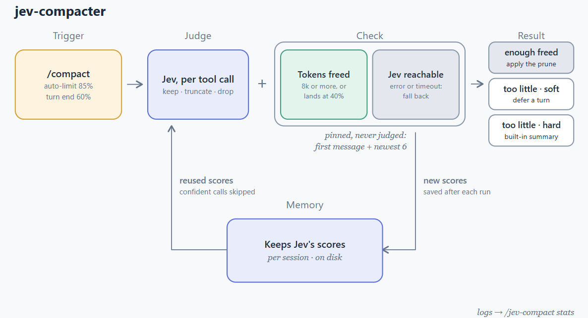

# jev-compacter

Replaces Claude Code's built-in compaction summary with a prune: Jev judges each tool call in the conversation, and stale ones are dropped or cut short. Everything else stays word for word.

## When it runs

| Trigger | Level |
|---|---|
| you type `/compact` | `manual` |
| Claude Code auto-compacts near its limit, or [while idle](#claude-codes-own-idle-compaction) | `hard` |
| a turn ends with the context ≥ 60% full and grown ≥ 10% since the last compaction | `soft` (≥ 85% gives `hard`) |
| the prompt cache is gone and the context is > 40% full | `idle`, see [below](#when-the-prompt-cache-expires) |
| a subagent compacts, or a precompute | skipped: built-in behaviour |

The level decides the fallback when the prune doesn't help enough.

## When the prompt cache expires

Claude Code caches the conversation so each request re-reads it cheaply. The cache expires after a period of inactivity: one hour for the main conversation on a subscription within its plan's usage, five minutes otherwise ([prompt caching](https://code.claude.com/docs/en/prompt-caching#cache-lifetime)). A model switch or a resumed old session loses it too. The next message then re-reads the whole conversation uncached.

That is the cheapest moment to prune. A prune rewrites the history, which normally costs a cache miss, but the miss is coming anyway, so pruning first only makes it smaller. Claude Code's built-in summary is the opposite: its request re-reads the whole history uncached, which is why `/compact` costs the most after a break. So this path only ever prunes, and never falls back to the summary.

| When | What happens |
|---|---|
| no main-loop request for one cache lifetime (+15 s) | checked while you're away |
| a session resumed after its cache expired | checked 2 s after it starts |
| `/model` switches to another model | checked 2 s after the switch |
| any main-loop turn starts | the check is cancelled; the cache is warm again |

The check asks Python whether a prune is worth it (`idle` needs the context above the 40% target and grown 10% since the last compaction). If so, with `jev_compacter_cold_cache`:

- `ask` (default): a dialog asks *Prune now* or *Not now*. It waits for your answer unless you set Claude Code's `askUserQuestionTimeout`.
- `auto`: prunes without asking.
- `off`: nothing.

There is one offer per idle period. The prune runs as `/compact` at the `idle` level: it's applied if it frees anything at all (the cache is cold anyway), otherwise deferred.

The cache lifetime comes from `jev_compacter_cache_ttl` (`auto`, `5m`, `1h`). `auto` follows Claude Code's own order: `FORCE_PROMPT_CACHING_5M`, then `CLAUDE_CODE_PROMPT_CACHE_TTL`, then the `promptCacheTtl` setting, then `ENABLE_PROMPT_CACHING_1H`, then one hour if the account reports subscription rate limits under 100%, else five minutes. After a `/model` switch, the lifetime Claude Code reports is used. Set it by hand behind a gateway or provider where `auto` guesses wrong.

### Claude Code's own idle compaction

Since v2.1.290, Claude Code summarizes a conversation of 200K+ tokens after about 54 minutes idle on the one-hour cache, before the cache expires (`idleCompaction`; turn it off with `"idleCompaction": false`). It reaches hooks as an `auto` compaction, so it runs here as `hard`. The prune replaces the summary only if it frees something and lands below 60%; otherwise the summary runs as Claude Code intended. After it, the cold-cache check finds nothing left to prune.

## One compaction, step by step

1. **Pair calls with results.** Calls in the first message and in the newest 6 messages are **pinned**: never sent to Jev, never touched.
2. **Reuse what's known.** Jev's scores from earlier compactions in this session are reused unless they were close to the threshold.
3. **Build what Jev sees.** The whole conversation with every tool output replaced by a size note. If it's over 25k tokens it is shrunk in stages (shorter inputs, head-and-tail texts, collapsed old messages).
4. **Ask Jev.** Two questions per call, batched and run in parallel: should the *call* stay, and should its *full output* stay?
5. **Decide each call** (threshold 0.5):
   - output should stay → **keep**
   - only the call should stay → **truncate**: first 300 characters of the output plus a note to re-run the tool
   - neither → **drop** the call and its output
6. **Judge the result:**

| Level | Applied if | Otherwise |
|---|---|---|
| `hard` | it frees something and lands below 60% | built-in summary |
| `manual` | it frees something, and lands at ≤ 40%, or frees ≥ 8000 tokens, or the cache is cold | built-in summary |
| `soft` | same as manual | deferred to a later turn, scores kept |
| `idle` | same as manual; the cache is always cold here, so anything freed | deferred, scores kept |
| Jev fails | — | summary for hard/manual, defer for soft/idle |

7. **Hand back.** Kept messages are returned as indexes into the original list, so unchanged messages are reused exactly as Claude Code had them.

## Memory

Jev's scores per tool call are kept in the session's log file, tagged with a fingerprint of the tool and its input. A remembered score is reused only if that call is still in the conversation with the same input, so rewinds and edits never reuse stale answers. The file is removed when the session's transcript is gone.

## Files

| File | Role |
|---|---|
| [`tool.py`](../src/optim_jev/tools/jev_compacter/tool.py) | entry point: modes `check`, `compact`, `stats` |
| [`policy.py`](../src/optim_jev/tools/jev_compacter/policy.py) | *when* to compact, and *whether* to apply the result |
| [`logic.py`](../src/optim_jev/tools/jev_compacter/logic.py) | asks Jev, decides per call, rebuilds the messages |
| [`state.py`](../src/optim_jev/tools/jev_compacter/state.py) | what Jev sees, shrunk to fit |
| [`jev.py`](../src/optim_jev/tools/jev_compacter/jev.py) | HTTP client for Jev, shared by all tools; counts usage |
| [`store.py`](../src/optim_jev/tools/jev_compacter/store.py) | memory and outcome records in the session log |
| [`stats.py`](../src/optim_jev/tools/jev_compacter/stats.py) | `/jev-compact stats` |
| [`config.py`](../src/optim_jev/tools/jev_compacter/config.py) | defaults |
| [`types.py`](../src/optim_jev/tools/jev_compacter/types.py) | frozen dataclasses |

## Settings

### Pick a style

Most people only need one setting. In Claude Code, type `/config`, find **Compaction: style** under optim-jev, and pick one. It applies from the next session.

| Style | For | Prunes from | Keeps a tool call if Jev rates it | Also |
|---|---|---|---|---|
| `balanced` (default) | most sessions | 60% full | ≥ 0.5 | |
| `save-tokens` | long sessions, paying per token | 50% full | ≥ 0.6, so more is dropped | applies a prune freeing ≥ 4000 tokens |
| `keep-context` | work that keeps going back to old output | 70% full | ≥ 0.35, so more is kept | the newest 10 messages are never touched |

A number you set yourself (soft threshold, keep threshold, minimum tokens freed, recent messages kept) overrides the style.

### What to change when

| You notice | Change |
|---|---|
| Claude forgot a file or output it needed | style `keep-context`, or raise **recent messages kept** |
| still reaching the limit, or sessions cost too much | style `save-tokens` |
| the *Prune now* question after a break is unwelcome | **when the prompt cache expires**: `auto` or `off` |
| that question comes at the wrong time, e.g. behind a gateway | **prompt cache lifetime**: `5m` or `1h` |
| you want Claude Code's own summary back | **Compaction: Jev**: `off` |

### All settings

Defaults are in [`config.py`](../src/optim_jev/tools/jev_compacter/config.py). The ones exposed in `/config` are listed in [Getting started](getting-started.md#options). Others are read from options too but not declared in the manifest: `max_state_tokens` (25000), `max_request_tokens` (30000), `truncate_head_chars` (300), `reask_margin` (0.15), `regrow_percent` (10), `model`, `base_url`.

## Known gaps

- Only tool calls and their outputs are judged; Claude's own text replies are never pruned.
- Tokens freed are estimated without a tokenizer.
- Cache expiry is estimated from the time of Claude's last response; other ways to lose the cache (an MCP server change, fast mode) aren't detected.
- Text after `/compact` is only used if the built-in summary runs.
